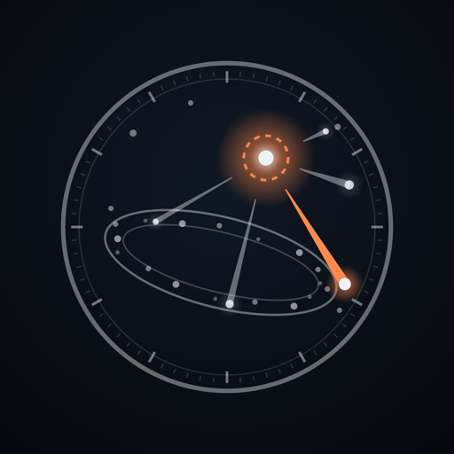
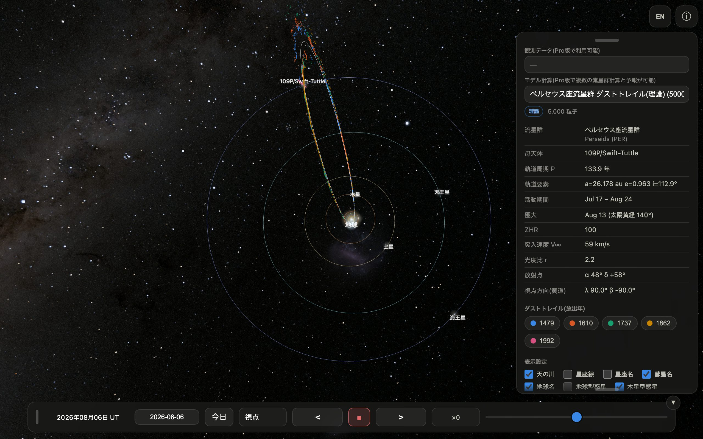

# Meteorium メテオリウム — Meteor Dust Trails

流星群のもとになる「ダストトレイル」（彗星が軌道上に残した塵の帯）を、実際の軌道計算に
基づいて 3D 表示するアプリです（iPhone / iPad / Mac）。
**このリポジトリではマニュアルとサポート情報のみを配布しています**（ソースコードは非公開）。

Meteorium visualises the dust trails behind meteor showers in 3D, computed with
real orbital dynamics, for iPhone, iPad and Mac. **This repository distributes
the manuals and support pages only** — the source code is not public.

App Store: https://apps.apple.com/app/id6798546441

## Manual / マニュアル

| | iPhone / iPad | Mac |
|---|---|---|
| Web（日本語・English） | [manual/](https://nu-sx.github.io/METEORIUM/manual/) | [manual/mac.html](https://nu-sx.github.io/METEORIUM/manual/mac.html) |
| 日本語 (Markdown) | [meteorium_manual_ja.md](manual/meteorium_manual_ja.md) | [meteorium_manual_mac_ja.md](manual/meteorium_manual_mac_ja.md) |
| English (Markdown) | [meteorium_manual_en.md](manual/meteorium_manual_en.md) | [meteorium_manual_mac_en.md](manual/meteorium_manual_mac_en.md) |

Support page / サポートページ: https://nu-sx.github.io/METEORIUM/

## Privacy / プライバシー

[プライバシーポリシー](https://nu-sx.github.io/METEORIUM/privacy-policy.ja.html) /
[Privacy Policy](https://nu-sx.github.io/METEORIUM/privacy-policy.en.html)

## Data / データ

The Leonid datasets of Abe (2026) that the app reads are archived at Zenodo,
[10.5281/zenodo.22004211](https://doi.org/10.5281/zenodo.22004211), and mirrored at
[nu-sx/meteor_forecast](https://github.com/nu-sx/meteor_forecast).

アプリが読み込むしし座流星群の論文データ (Abe 2026) は Zenodo
([10.5281/zenodo.22004211](https://doi.org/10.5281/zenodo.22004211)) に保管され、
[nu-sx/meteor_forecast](https://github.com/nu-sx/meteor_forecast) にも置いてあります。

## Contact / お問い合わせ

avellsky@gmail.com

© Meteorium, Avellsky
