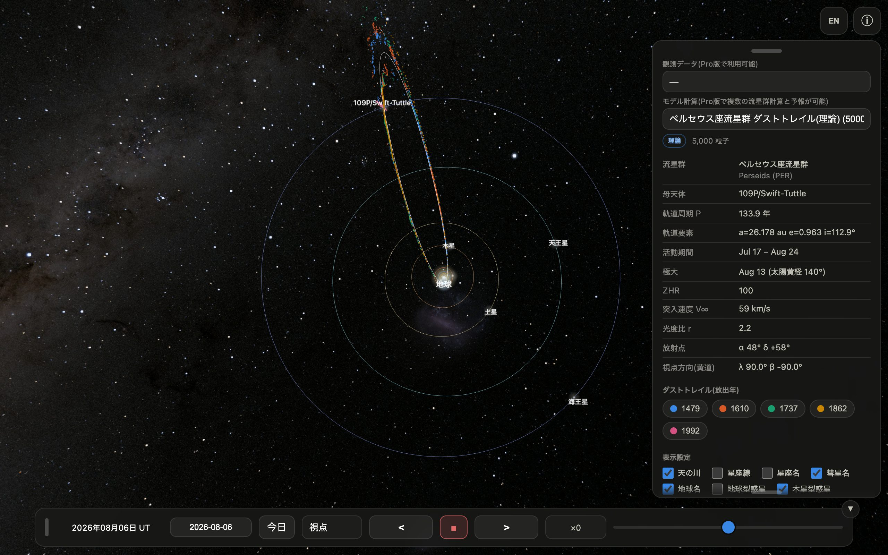
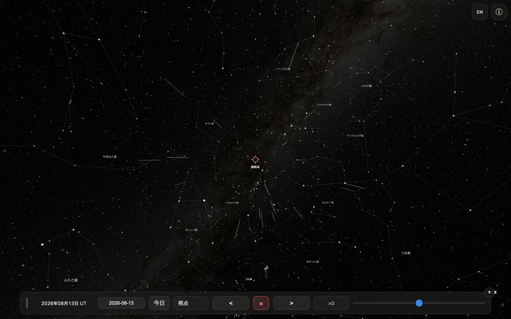
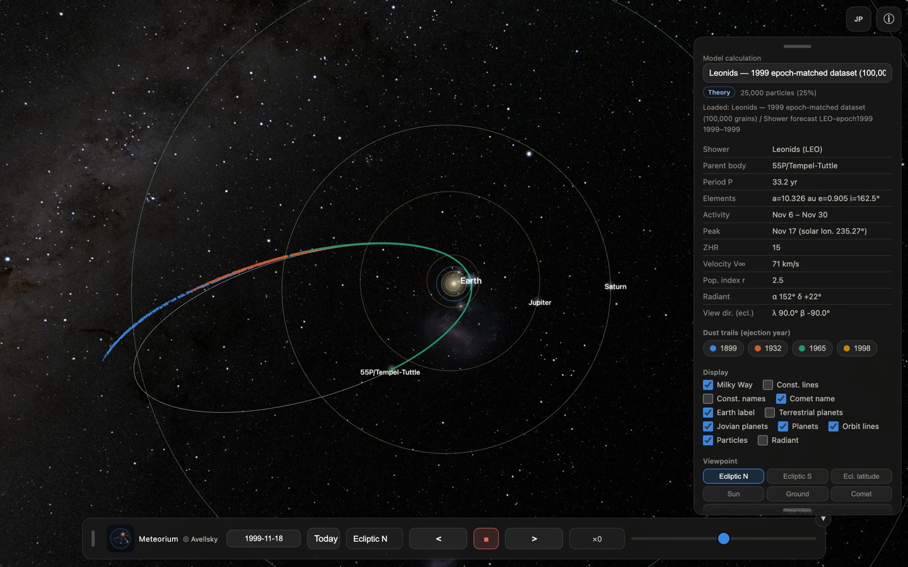
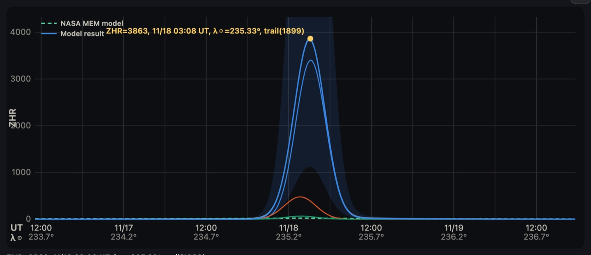
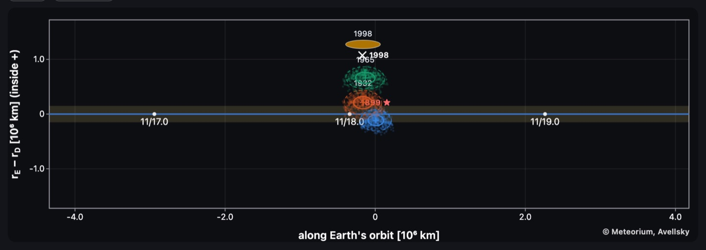
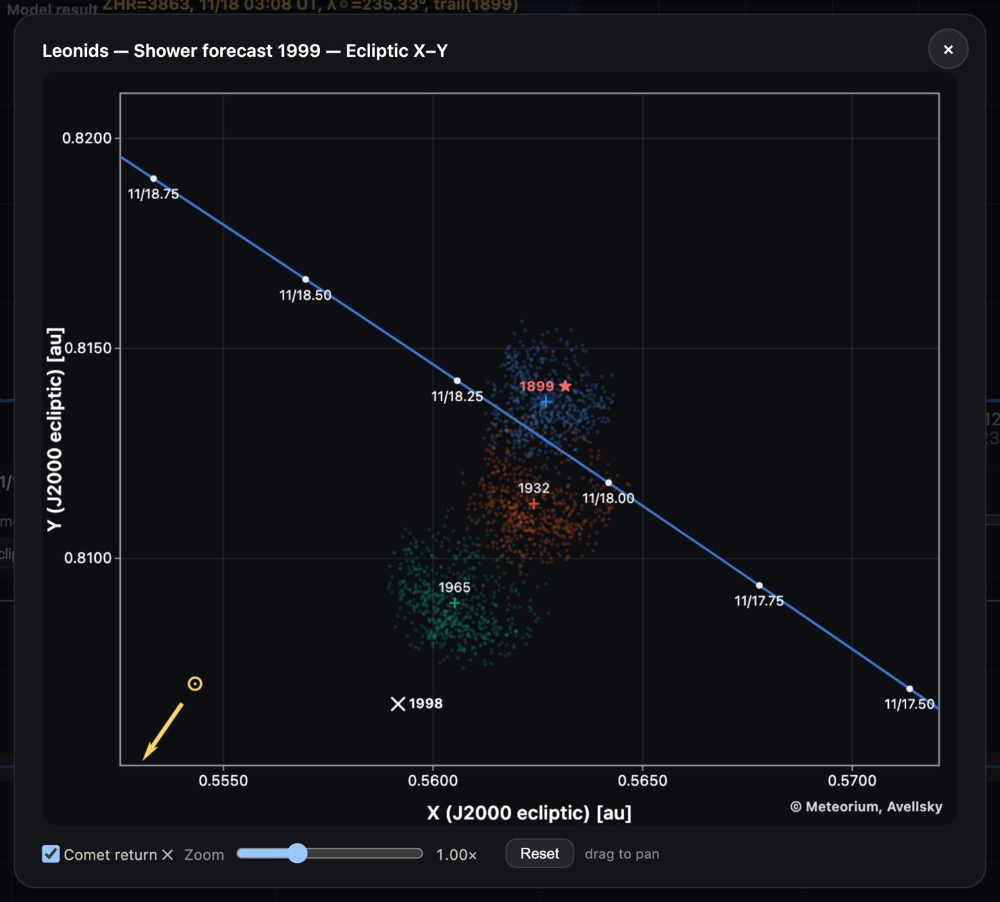

# Meteorium User Manual (Free Edition)

Meteorium visualises the "dust trails" — ribbons of comet dust that produce
meteor showers — in 3D, based on real orbital dynamics. This app
ships with **60,000 dust grains from eight perihelion returns (1079, 1209,
1344, 1478, 1609, 1736, 1862, 1992) of comet 109P/Swift-Tuttle**, the parent
of the Perseids.

- Orbits integrated with REBOUND/ReboundX (planetary gravity + solar
  radiation pressure)
- Sky background: NASA Deep Star Maps 2020 (8K)
- All computation on your device; no data collection, no ads (it goes online only to fetch the published datasets)
- A bundled **Perseid shower forecast (display) for 2026** and the **Leonid forecasts for 2030-2035**, shipped precomputed (this app contains no forecast engine). The Model calculation menu can also pull in the datasets published with the paper

## Screen layout

- Centre: 3D view (drag = rotate, pinch/wheel = zoom)
- Top right: EN/JP language toggle, ⓘ panel toggle
- Right panel: dataset, trail legend, display settings, viewpoints,
  particle settings
- Bottom bar: date/time (UT), date entry, Today, viewpoint menu,
  time controls

Panels can be dragged anywhere by their grips; the side panel's height is
adjustable from its bottom grip.

- The **▼** button on the bottom bar collapses it to a single ▲ button
- In landscape the speed slider gets its own full-width second row
- Rotating the device always brings the panels back on screen

## Dust trails

Colored chips list the trails by ejection year; tap to toggle each.
"1992" is the freshest dust (perihelion 1992-12-11); older trails have
stretched along the orbit.

## Display settings

Milky Way / constellation lines / names / comet name / Earth label /
terrestrial planets / giant planets / planets / orbit lines /
**particles** / radiant. Defaults on launch: constellation lines & names,
terrestrial planets and the radiant start OFF (this app always starts
from these defaults).

## Viewpoints

- **Ecliptic N**: top-down; each press rotates 45° clockwise
  (**Ecliptic S**: counter-clockwise)
- **Ecl. latitude**: keeps the current longitude, steps latitude by 30°
- **Sun**: pinned to the Sun; presses cycle vernal-equinox → comet
  tracking → Earth tracking (caption top-left; tracking survives drags)
- **Earth**: ground view toward the radiant (see below)
- **Comet**: rides the comet; presses cycle front camera → rear camera →
  split screen (rear|front) → front (captions top-left)
- **Free view**: an auto tour — every 10 s the view and zoom move to a
  fresh, well-framed angle; press again or drag to stop

Entering the ground view switches the radiant, constellation lines and
names ON automatically; leaving it switches the radiant back OFF.

## The ground-view meteor shower

From the ground you watch meteors radiate from the shower radiant
(displayed at a fixed ZHR of 5,000), **only within the shower's activity
period** (Perseids: Jul 17 – Aug 24).

- Meteors appear all over the sky; their paths trace back to the radiant
- Near the radiant: slow, short, bold — far away: fast, long, faint
- Fireballs (~7%) may leave a **persistent train** that drifts and fades
- Meteor clusters (~4%): many parallel meteors within a couple of seconds
- Stationary meteors (~2%): a point flash at the radiant (head-on entry)
- Planets show their true colours and apparent magnitudes

## Time controls

- Date field (BC via negative years), **Today**
- **■** toggles stop ⇄ real-time (×1)
- **< / >** step ×2 → ×10 → ×100 → ×500 → ×1000 → ×5000 → ×10000
- Slider: stepless speed, centre = stopped

## Particles

Rendered fraction 10/25/50/100% and size L/M/S.

## What's new in 1.1

Version 1.1 opens the paper's own results inside the app. The figures below set the
model's forecast for the 1999 November 18 Leonid storm **against what was actually
observed that night**.

**Published data, loaded in the app** — the Model calculation menu now offers
"Fetch published data...". It lists the Leonid datasets published with the paper
(the epoch-matched simulations for 1998, 1999, 2000, 2001, 2002 and 2009) and pulls
in whichever you pick. Choosing a dataset also sets the forecast year for you.

Fig.: the 1999 epoch-matched dataset, just loaded. Four dust trails left by
55P/Tempel-Tuttle in 1899, 1932, 1965 and 1998 reach inside Earth's orbit.

**The Leonid forecasts for 2030-2035** ship with the app. Each year is computed, as
in the manuscript, from a dataset matched to that encounter's epoch.

Fig.: **the 1999 forecast set against what was observed.** The model puts the maximum
at 03:08 UT on November 18, from the 1899 trail, at ZHR 3863; the storm itself was
recorded at 02:02 UT, ZHR 3700. The predicted time and size can be checked against
what actually happened.

**Two cross-section views** show where in the trail the Earth actually passes.

Fig.: distance along Earth's orbit across, radial miss distance up. Only the 1899
trail sits on Earth's path.

Fig.: the ecliptic-plane X-Y view, putting the dated ticks along Earth's orbit and
the grain scatter of each trail on the same plane.

**Also in 1.1** — the viewpoint menu on the bottom bar shows which viewpoint is in
effect; the ground view lets the meteor rate be set to ZHR 100 / 1000 / 5000 /
10000 / 100000; dataset names are written consistently.

## About the forecast model

Trail forecasts integrate the dust released at each perihelion return of
the parent comet forward to the present with REBOUND/ReboundX (planetary
perturbations, radiation pressure, Poynting-Robertson drag), then
evaluate the encounter at the trail's ecliptic node.

- **Ejection**: Crifo & Rodionov (1997) gas-drag terminal-speed law,
  sizes drawn directly from dN proportional to a^-u, radiation-pressure
  parameter beta = 5.74e-4/(rho a)
- **Parent position**: dust ejection sites are anchored to the JPL
  Horizons ephemeris, which uses an orbit solution fitted to each
  historical apparition. A self-consistent back-integration of 55P
  instead drifts 0.08-0.15 au over 130 yr and more than 1 au before
  1700, which biases every trail generated from it.
- **Annual background**: measured activity profiles from NASA MEO
  (Moorhead et al. 2019)
- **Confidence class**: each forecast carries a band - A (0.5-2.0x),
  B (0.29-3.5x) or C (0.1-10x) - set per shower from how well the model
  reproduces that shower's documented past encounters.

Shower parameters follow the IMO Meteor Shower Calendar.

### Source of the forecast model

The Leonid forecast model, and the 2030-2035 values shipped with the app,
come from the following manuscript, currently submitted to *Icarus*:

> Shinsuke Abe (2026) "A calibrated dust-trail model of the Leonid meteoroid
> stream and forecasts of the 2031-2035 encounters", submitted to *Icarus*.

Each year is computed, as in the manuscript, from a dataset matched to the
epoch of that encounter. Reading every year off a single snapshot instead
leaves out the planetary motion of the trail nodes since then, which
reverses which trail dominates the 2034 encounter. The datasets behind the
computation are published at Zenodo (DOI: 10.5281/zenodo.22004211).

---
© Meteorium, Avellsky
