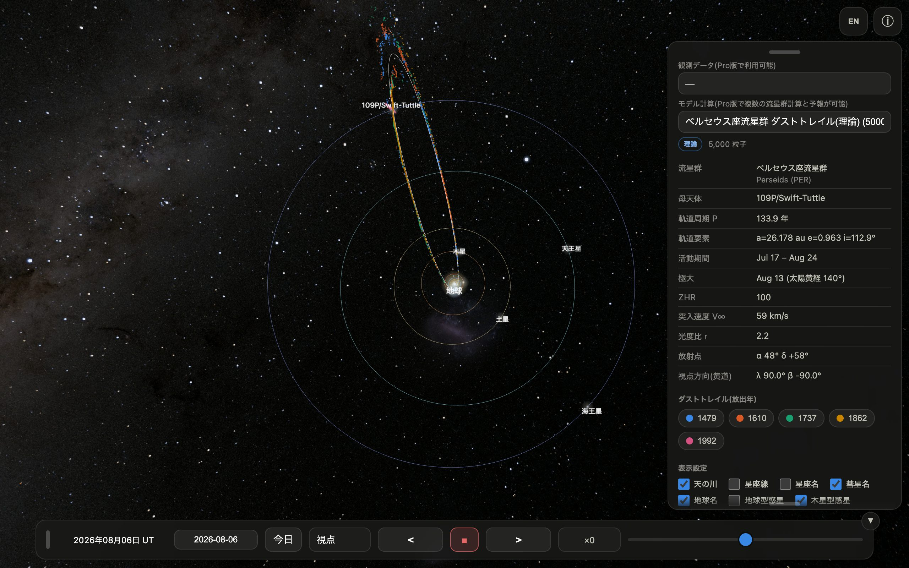
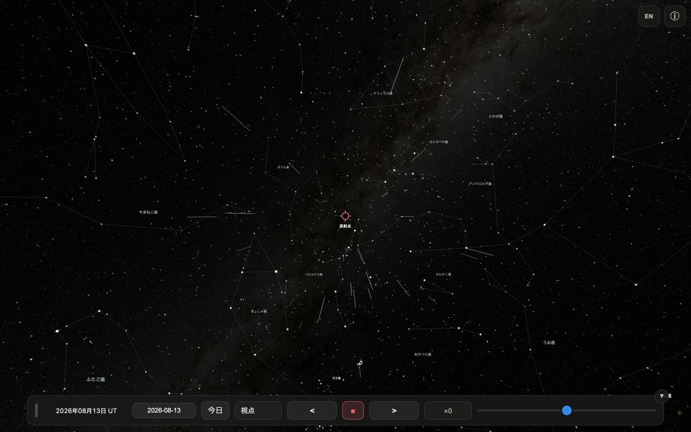
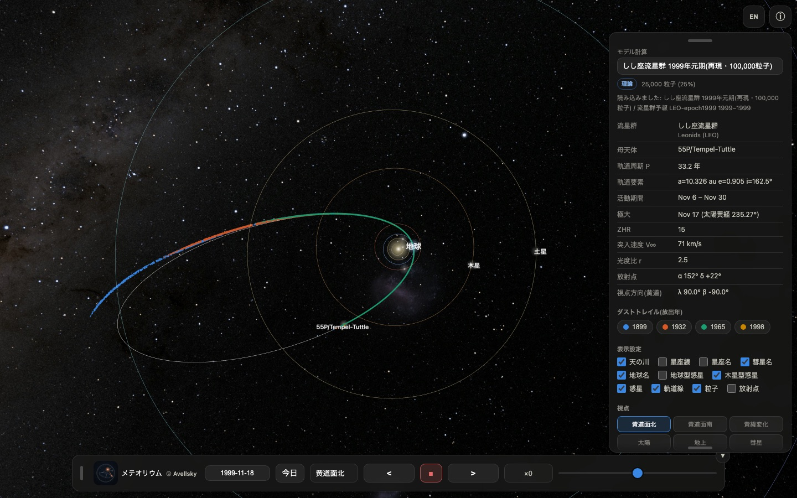
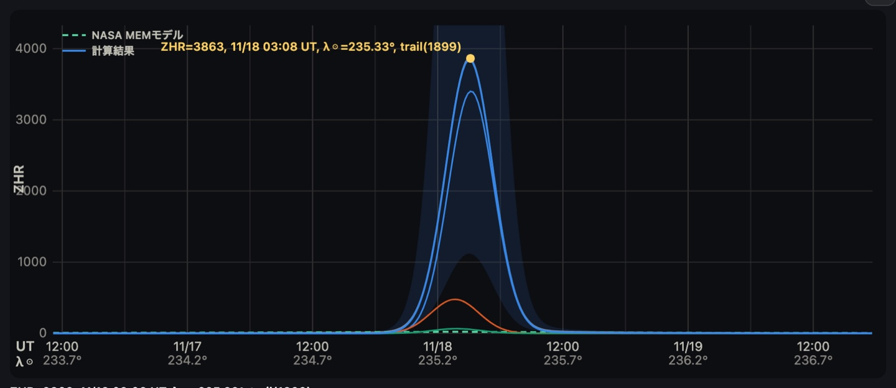
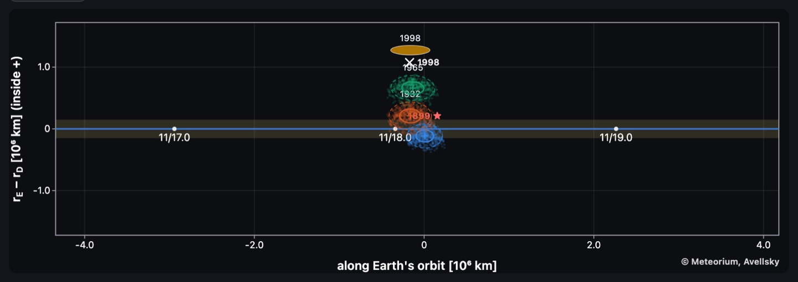
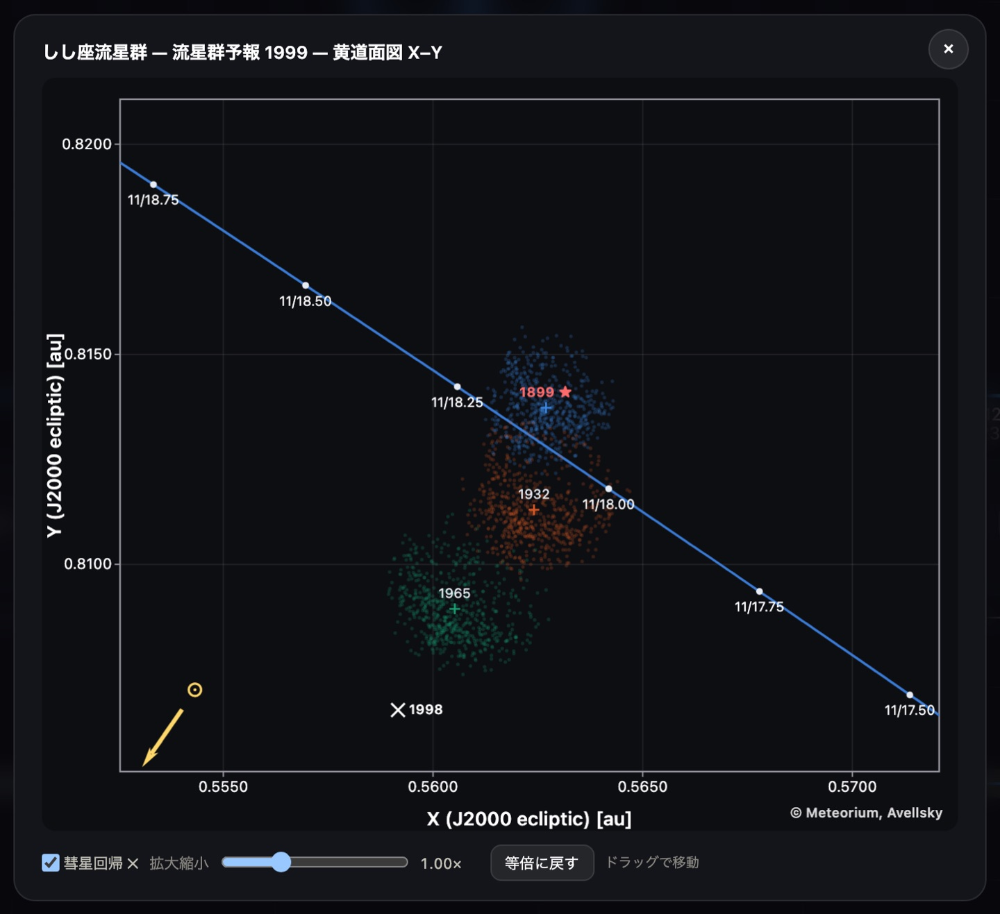

# Meteorium ユーザーマニュアル

Meteorium は、流星群のもとになる「ダストトレイル」(彗星が軌道上に残した塵の帯)を
科学計算に基づいて 3D 表示する天文アプリです。本アプリには、ペルセウス座流星群の
母彗星 109P/スウィフト・タトルが残した **8回帰ぶん(1079・1209・1344・1478・
1609・1736・1862・1992年)のダストトレイル 60,000 粒子** が収録されています。

- 粒子の軌道は REBOUND/ReboundX による軌道積分(惑星重力+太陽放射圧)で計算
- 背景の空は NASA「Deep Star Maps 2020」8K 全天図
- 計算・描画はすべて端末内。データ収集・広告なし(公開データを取得するときだけ通信します)
- ペルセウス座流星群の**2026年の流星群予報(表示)**と、**しし座流星群の 2030–2035年の予報(表示)**を収録。予報値はあらかじめ計算したものを表示します(本アプリに計算機能は含まれません)。「モデル計算」のメニューから、論文で公開しているデータをさらに取り込むこともできます

---

## 1. 画面の構成

| 場所 | 内容 |
|---|---|
| 中央 | 3D 表示(ドラッグ=視点回転、ピンチ/ホイール=ズーム)|
| 右上 | EN/JP(言語切替)、ⓘ(パネル開閉)|
| 右パネル | データセット・ダストトレイル凡例・表示設定・視点・粒子設定 |
| 下部バー | 日時(UT)・日付入力・今日・視点・時間操作 |

パネルと下部バーは、つまみ(グリップ)をドラッグして画面内の好きな位置に移動できます。
パネル下端のつまみで表示の長さも調整できます。

- 下部バー右上の **▼** ボタンでバー全体を畳めます(▲ タップで復元)
- iPhone を横向きにすると、速度スライダーは下部バーの2段目に全幅で表示されます
- 画面を回転してパネルが画面外に出た場合は、自動で定位置に戻ります

## 2. ダストトレイル(放出年)

凡例の色付きチップは放出年ごとのトレイルです。タップで個別に表示/非表示を
切り替えられます。色は 3D 粒子と対応しています。

- **1992**: 前回回帰(1992年12月12日)で放出された最も新しい塵
- **1079〜1862**: 過去7回の回帰で放出され、軌道に沿って広がった塵(古いものほど拡散)

## 3. 表示設定

天の川 / 星座線 / 星座名 / 彗星名 / 地球名 / 地球型惑星 / 木星型惑星 / 惑星 /
軌道線 / **粒子** / 放射点 の ON/OFF。

起動時の既定値: 星座線・星座名・地球型惑星・放射点が OFF、他は ON。
(本アプリは毎回この既定値で起動します)

## 4. 視点

| ボタン | 動作 |
|---|---|
| **黄道面北** | 太陽系を真上から。押すたびに 45° ずつ時計回りに回転 |
| **黄道面南** | 真下から。押すたびに 45° ずつ反時計回り |
| **黄緯変化** | 現在の黄経を固定し、押すたびに黄緯を 30° ずつ変化(子午線を一周)|
| **太陽** | 太陽中心に固定。押すたびに 1) 春分点方向 → 2) 彗星追尾 → 3) 地球追尾。左上に現在モードを表示。ドラッグしても追尾は継続 |
| **地球** | 地上から放射点方向を見る観察視点(下記 5 章)|
| **彗星** | 彗星と一緒に移動。押すたびに 1) 前方カメラ → 2) 後方カメラ → 3) 2画面(左=後方/右=前方)→ 1) に戻る。左上にカメラ名を表示 |
| **フリー視点** | 10秒ごとに見やすい視点と倍率へ自動で移り変わる観賞モード。もう一度押すかドラッグで停止 |

地球視点に入ると放射点・星座線・星座名が自動 ON、離れると放射点は自動 OFF になります。

## 5. 地球視点の流星ショー

地上からの視点では、放射点から流星が流れる様子を再現します(表示は ZHR=5,000 相当)。

- **活動期間**(ペルセウス座群: 7/17〜8/24)の日付のときだけ発生します
- 流星は全天(放射点の反対側も)に出現し、経路の延長は必ず放射点を通ります
- 放射点付近: 遅く・短く・太く明るい / 離れるほど: 速く・長く・細く暗い(実際の遠近効果)
- **火球**(約7%): ひときわ明るい大流星。あとに**永続痕**(数秒間漂う光の筋)を残すことがあります
- **流星クラスター**(約4%): 数秒間に多数の流星が同じ領域から平行に流れる珍現象
- **静止流星**(約2%): 放射点の真芯で、動かない点がふっと光る「正面から来る流星」
- 惑星は実際の**色と等級**(金星は明るく、海王星はほぼ見えない)で表示されます

## 6. 時間操作

- **日付欄**: 任意の日付を入力(紀元前はマイナス年)。**今日** で現在に戻る
- **◼️(停止)**: 押すと停止、もう一度押すと**実時間(×1)**で進行
- **< / >**: 押すたびに ×2 → ×10 → ×100 → ×500 → ×1000 → ×5000 → ×10000 と増速(< は逆行)
- **スライダー**: 中央=停止、左右で無段階の速度調整

## 7. 粒子設定

- **表示粒子数**: 10 / 25 / 50 / 100%(動作が重い端末では減らしてください)
- **表示粒子サイズ**: 大 / 中 / 小

## 8. 言語

右上のボタンで日本語 ⇄ 英語を切り替え(EN=英語へ、JP=日本語へ)。

## バージョン 1.1 の新機能

1.1 では、論文の計算結果そのものをアプリの中で開けるようにしました。以下の図は、
1999 年 11 月 18 日のしし座流星群の大出現について、**モデルの予報と実際の観測結果を
突き合わせた**ものです。

**公開データを直接読み込める** — 「モデル計算」のメニューに「公開データを取得…」が
加わりました。論文で公開しているしし座流星群のデータセット(1998・1999・2000・2001・
2002 年の元期整合データと 2009 年)を、その場で取り込めます。データを選ぶと予報年も
自動で設定されます。

図: 1999 年元期のデータを読み込んだところ。55P/テンペル・タットルが残した
1899・1932・1965・1998 年の 4 本のダストトレイルが地球軌道の内側に伸びています

**しし座流星群 2030–2035 年の予報を収録** — 論文の 2030 年代の予報を、開いたその場で
見られます。各年は論文と同じく遭遇年ごとに元期を合わせたデータから計算した値です。

図: **1999 年の予報（モデル）と観測結果の比較。** モデルは 1899 年トレイルによる
11 月 18 日 03:08 UT の極大、ZHR 3863 を与えます。実際に観測された大出現は
02:02 UT、ZHR 3700 でした。予報の時刻・規模を、起きたことと突き合わせて確かめられます

**ダストトレイル断面図は 2 種類** — 地球がトレイルのどこを通り抜けるのかを 2 つの図で
確かめられます。

図: ダストトレイル断面図。横軸は地球の軌道に沿った距離、縦軸は地球軌道からの動径方向の
ずれ。1899 年トレイルだけが地球の通り道に重なっています

図: 黄道面図 X–Y。地球の軌道上の日付目盛りと各トレイルの粒子の散らばりを同じ平面で
見比べられます

**そのほか** — 下部バーの視点メニューが現在の視点名を表示するようになりました。
「地上」の視点では流星の出現頻度を ZHR 100 / 1000 / 5000 / 10000 / 100000 から選べます。
データセット名の表記も統一しました。

## 9. 予報モデルについて

ダストトレイル予報は、母彗星の各近日点回帰で放出された塵を N 体積分
(REBOUND/ReboundX、惑星摂動・輻射圧・ポインティング–ロバートソン効果)
で現在まで追跡し、地球軌道との交点(ノード)での遭遇を評価します。

- **放出モデル**: Crifo & Rodionov (1997) のガス抗力終端速度則、サイズ分布
  dN ∝ a^−u からの直接抽選、輻射圧パラメータ β = 5.74×10⁻⁴/(ρa)
- **母彗星の位置**: 塵の放出地点は JPL Horizons 暦(回帰ごとの観測フィット解)に
  基準を合わせています。自前の逆積分では 55P の場合 130 年で 0.08–0.15 au、
  1700 年以前では 1 au 以上ずれ、これがトレイル位置の系統誤差になるためです
- **年間背景**: NASA MEO(Moorhead et al. 2019)の実測活動プロファイル
- **信頼度クラス**: 予報値には A(0.5–2.0 倍)/ B(0.29–3.5 倍)/ C(0.1–10 倍)の
  幅を付記します。クラスは流星群ごとに過去事例の再現成績から決めています

各流星群の活動期間・極大・ZHR・突入速度 V∞・光度比 r・放射点は
IMO Meteor Shower Calendar に準拠しています。

### 予報モデルの出典

しし座流星群の予報モデルと 2030–2035 年の予報値は、次の論文に基づいています。
本稿は現在 *Icarus* に投稿中です。

> Shinsuke Abe (2026) "A calibrated dust-trail model of the Leonid meteoroid
> stream and forecasts of the 2031–2035 encounters", submitted to *Icarus*.

各年の予報は、論文と同じく**遭遇年ごとに元期を合わせたデータセット**から
計算した値を収録しています。単一のスナップショットから全年を読むと、
惑星摂動でトレイルの節が動いた分が反映されず、2034 年はどちらのトレイルが
優勢かが入れ替わります。計算に使ったデータセットは Zenodo で公開しています
(DOI: 10.5281/zenodo.22004211)。

---
© Meteorium, Avellsky
